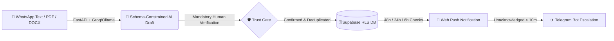

<div align="center">

# 🎯 DriveTrack — AI Placement Drive Tracker

**Turn chaotic college placement WhatsApp messages and PDF circulars into structured, zero-miss deadline pipelines.**

[](https://www.drivetrack.page)
[](https://github.com/Keval2609/Placement_Tracker/actions)
[](https://fastapi.tiangolo.com)
[](https://vite.dev)
[](https://supabase.com)
[](https://clerk.com)
[](https://www.python.org)

[**🚀 Explore Live App (Includes 1-Click Mock Showcase)**](https://www.drivetrack.page) • [**⚙️ Production API**](https://placement-tracker-yzdq.onrender.com)

</div>

---
## 💡 Why DriveTrack?

Campus placement announcements arrive across fragmented WhatsApp forwards, 10-page PDFs, and last-minute schedule changes—leading to missed deadlines and spreadsheet fatigue. 

**DriveTrack** solves this by combining **schema-constrained LLM extraction** with a **strict human-in-the-loop verification gate** and a **multi-channel escalation alert engine**, ensuring students never miss an application deadline or OA round.

---

## ⚡ How It Works (The 30-Second Flow)



---

## 🏆 Key Engineering Highlights

*   **🛡️ Human-in-the-Loop AI Trust Gate:** AI-extracted dates (`application_deadline`, `oa`, `interview`, etc.) render as confidence badges alongside verbatim source text. Users can edit any field, confirm dates individually, or use the **1-click "Confirm All"** action, while the backend (`HTTP 422`) strictly verifies that at least one primary application deadline is confirmed.
*   **💼 Dual-Track Ingestion (Campus AI vs. Off-Campus Direct Entry):** Switch seamlessly between **Campus Drive (AI Notice Parser)** for WhatsApp/circular parsing and **Off-Campus Job Application (Manual Entry)** for direct tracking. Off-campus entries bypass LLM parsing entirely and record status pipelines (`applied`, `oa`, `interview`, `offer`, `rejected`) and job descriptions directly.
*   **📌 Intelligent Active Pipeline Retention:** Drives with active applications (`applied`, `oa`, `interview`) remain retained in the **Active Drives** dashboard section even after their initial application deadline has elapsed, designated with an *"In Pipeline (Closed)"* badge until reaching a terminal state (`Offer` or `Rejected`).
*   **📋 Full-Fidelity Job Description & Specs Display:** The drive detail page features a dedicated **Job Description & Key Requirements** card with whitespace/markdown formatting preservation, 1-click clipboard copy, and quick specs breakdown (CGPA cutoff, eligible academic branches, application link).
*   **🔔 Multi-Channel Alert & Telegram Escalation Engine:** Background `APScheduler` workers scan IST deadlines at **48h, 24h, and 6h** intervals. If a PWA Web Push notification goes unacknowledged for **> 10 minutes**, the escalation engine automatically fires a fallback alert via the **Telegram Bot API**.
*   **📱 Android OEM Battery Killer Detection:** Mobile OS skins (Xiaomi/MIUI, Samsung, OnePlus, Oppo, Vivo) aggressively kill background service workers. DriveTrack inspects `navigator.userAgentData`, runs an onboarding push self-test, and renders brand-specific instructions (`dontkillmyapp.com`) if background delivery fails.
*   **🔄 Diff-Oriented Drive Updates & Audit Timeline:** Placement dates change frequently. Uploading a follow-up circular runs an **LLM Diff Pipeline** against the existing drive state, proposing only new or modified dates for human confirmation before merging into a chronological history timeline.
*   **🔒 Privacy-First Ingestion & Multi-Tenant RLS:** Enforces a strict `PII_SAFE_PROVIDERS` guard (restricting extraction to Groq/Ollama), graceful fallback to manual entry on LLM failure, and PostgreSQL Row-Level Security (RLS) anchored on Clerk JWTs.

---

## ✨ Core Product Features

| Module | Capabilities |
| :--- | :--- |
| **📊 Executive Dashboard** | Switch seamlessly between **Card Grid**, **Kanban Pipeline Funnel**, and **Dense Table** views with persistent `localStorage` filtering, search, and intelligent overdue retention for active applications. |
| **💼 Dual-Mode Ingestion** | Support for **On-Campus AI extraction** (Groq/Ollama parsing of WhatsApp texts and circulars) and **Off-Campus direct logging** with instant pipeline status assignment. |
| **📝 Job Details & Criteria** | Full-text Job Description viewer with preserved formatting, 1-click clipboard copy, quick criteria specs (CGPA cutoff, eligible departments), and external portal links. |
| **🎮 Zero-Setup Mock Mode** | Instant interactive showcase pre-loaded with realistic Tier-1 drives (Google, Microsoft, Goldman Sachs, Uber) for frictionless portfolio evaluation. |
| **🏷️ Smart Deduplication & Tagging** | Prevents duplicate entries via `HTTP 409` conflict checks on `(company, role, deadline)` and auto-classifies companies (`product`, `startup`, `service`, `psu`) using a zero-latency static lookup + LLM fallback. |

---

## 🛠️ Tech Stack

*   **Frontend:** React 18, TypeScript, Vite, Tailwind CSS, PWA Service Workers (Web Push / VAPID)
*   **Backend:** Python 3.11+, FastAPI, Pydantic, APScheduler, `pdfplumber`, `python-docx`
*   **AI Pipeline:** Groq API / Ollama (Schema-constrained JSON decoding, IST relative date resolution)
*   **Database & Auth:** Supabase (PostgreSQL + Storage + RLS), Clerk Authentication (JWKS validation)
*   **DevOps:** Docker Compose, GitHub Actions CI/CD (`pytest`, `ruff`, `eslint`), Render & Vercel

---

## 🗄️ Database Architecture & Security

The database uses **Supabase PostgreSQL** with Row-Level Security (RLS) isolating tenant data via a custom `requesting_user_id()` Postgres function mapped to Clerk JWT `sub` claims.

<details>
<summary><b>📐 Click to expand Entity-Relationship Diagram (Mermaid) & RLS Table</b></summary>

<br>


| Table | Purpose | Security & RLS Policy |
| --- | --- | --- |
| `companies` | Global directory of hiring organizations (`product`, `startup`, `service`, `psu`). | Readable by authenticated users; writes restricted to service role. |
| `drives` | Primary record for placement drives (role, CGPA cutoffs, branches, status). | RLS-isolated: `requesting_user_id() = user_id`. |
| `drive_dates` | Timeline milestones (`application_deadline`, `oa`, `interview`, `ppt`, etc.). | Scoped through parent `drives` ownership. |
| `drive_updates` | Audit log of incremental notices or revised date announcements. | Scoped through parent `drives` ownership. |
| `drive_documents` | Metadata for uploaded PDF/DOCX notices stored in Supabase Storage. | Scoped through parent `drives` ownership. |
| `applications` | Student recruitment pipeline tracking with set-once `applied_at` timestamp. | 1:1 with `drives`; owner-isolated. |
| `ingestion_log` | Diagnostic log tracking extraction attempts, input format, and errors. | Scoped through parent drive or restricted to service role. |

</details>

---

## 🚀 Quick Start & Local Development

<details>
<summary><b>💻 Click to expand Local Setup, Docker, Testing & API Reference</b></summary>

<br>

### Prerequisites
*   Docker + Docker Compose
*   Node.js 20+ & Python 3.11+

### 1. Backend & Database Setup

```bash
cd backend
cp .env.example .env
# Fill in SUPABASE_URL, SUPABASE_ANON_KEY, SUPABASE_SERVICE_ROLE_KEY, GROQ_API_KEY, CLERK_SECRET_KEY, CLERK_PUBLISHABLE_KEY and optional TELEGRAM_BOT_TOKEN
```

Run via **Docker Compose** (Recommended):
```bash
docker compose up --build
```

Or run locally via **Uvicorn**:
```bash
pip install -e .[dev]
uvicorn app.main:app --reload
```

### 2. Frontend Setup

```bash
cd frontend
cp .env.example .env      # Configure API Base URL + Supabase/Clerk keys
npm install
npm run dev
```

### 3. Testing & Quality Assurance

```bash
# Backend Test Suite & Linter
cd backend && pytest && ruff check .

# Frontend Typecheck, Lint & Production Build
cd frontend && npm run lint && npm run build
```

### 4. Core API Reference

| Method | Endpoint | Description | Auth Required |
| :--- | :--- | :--- | :---: |
| `POST` | `/ingest/text` | Parse raw placement message and extract structured draft via LLM | Yes (Clerk) |
| `POST` | `/ingest/file` | Extract draft from uploaded `.pdf` or `.docx` circular (up to 10MB) | Yes (Clerk) |
| `GET` | `/drives` | List user's tracked placement drives with status and deadlines | Yes (Clerk) |
| `POST` | `/drives` | Validate & persist confirmed drive (enforces human verification) | Yes (Clerk) |
| `GET` | `/drives/{id}` | Fetch full drive profile, company info, and confirmed timeline | Yes (Clerk) |
| `POST` | `/drives/{id}/updates` | Ingest follow-up circular and propose update diff against existing state | Yes (Clerk) |
| `PATCH` | `/drives/{id}/updates/{uid}/confirm` | Merge confirmed diff additions into timeline and update alerts | Yes (Clerk) |
| `GET` | `/drives/{id}/timeline` | Retrieve chronological update history and change diff summaries | Yes (Clerk) |
| `GET` | `/drives/{id}/documents` | List attached circulars with 5-minute signed download URLs | Yes (Clerk) |
| `PATCH` | `/applications/{id}` | Update recruitment funnel stage (`applied`, `oa`, `interview`, `offer`) | Yes (Clerk) |
| `GET` | `/push/vapid-public-key` | Retrieve VAPID public key for Web Push subscription | No |
| `POST` | `/push/subscribe` | Register service worker push subscription for deadline alerts | Yes (Clerk) |
| `POST` | `/push/ack` | Acknowledge alert receipt to cancel pending Telegram escalation | Yes (Clerk) |
| `POST` | `/telegram/link` | Link Telegram chat ID for fallback escalation notifications | Yes (Clerk) |
| `GET` | `/health` | API service liveness check | No |
| `GET` | `/health/scheduler` | APScheduler heartbeat monitor for alert background jobs | No |

</details>

---

## 📄 License

Distributed under the **Apache 2.0 License**. See [`LICENSE`](LICENSE) for details.