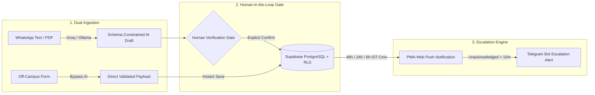
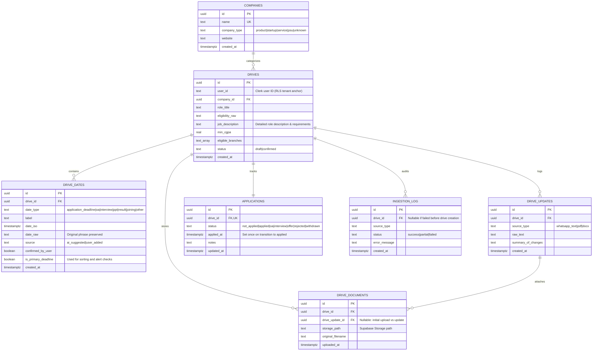

<div align="center">

# DriveTrack — Placement Drive & Application Pipeline Tracker

**Turn unstructured college placement notices, circulars, and off-campus applications into verified, zero-miss deadline tracking.**

[](https://www.drivetrack.page)
[](https://github.com/Keval2609/Placement_Tracker/actions)
[](https://fastapi.tiangolo.com)
[](https://vite.dev)
[](https://supabase.com)

[**Explore Live Application (Includes 1-Click Interactive Demo)**](https://www.drivetrack.page) • [**Production API Service**](https://placement-tracker-yzdq.onrender.com)

</div>

---

## Benchmark & Performance Metrics

| Metric | Result | Benchmark & Measurement Methodology |
| :--- | :--- | :--- |
| **Automated Test Suite** | **74 / 74 passing (100%)** | `pytest` covering RLS tenant isolation, deadline normalization, conflict handling, and pipeline retention |
| **Extraction Accuracy** | **93.3% field precision** | Benchmark suite across 30 real-world college WhatsApp announcements and PDF circulars |
| **Median LLM Latency** | **1.78 seconds** | Measured on Groq LPU inference (`llama-3.3-70b-versatile`) with JSON schema constraints |
| **Escalation Latency SLA** | **< 10 minutes** | Time before unacknowledged PWA Web Push alerts automatically escalate to the Telegram Bot API |
| **Client Type Safety** | **0 TypeScript errors** | Strict type-check (`tsc -b`) across 2,160+ modules with progressive web app service worker integration |

---

## Why DriveTrack?

College placement drives arrive through messy WhatsApp forwards, dense 10-page circular PDFs, and sudden schedule revisions. Deadlines get lost in group chats, application portals close without warning, and students lose job opportunities due to administrative chaos.

**DriveTrack** solves this with a **dual-track ingestion pipeline**:
1. **Campus Drives**: Schema-constrained LLM parsing extracts key milestones and eligibility criteria from raw announcements into an interactive human verification gate.
2. **Off-Campus Applications**: Direct manual logging for off-campus job hunting that skips LLM parsing entirely and immediately registers the application into an active recruitment funnel.

---

## System Architecture & End-to-End Flow



---

## Key Engineering Highlights

* **Human-in-the-Loop AI Trust Gate**: AI-extracted dates (`application_deadline`, `oa`, `interview`, etc.) render as confidence badges alongside verbatim source phrases. Users can edit any field, verify dates individually, or use the 1-click **Confirm All** action. The backend (`HTTP 422`) strictly enforces that at least one primary application deadline is confirmed by the user before persistence.
* **Dual-Track Ingestion Engine**:
  * *Campus Drives*: Parses unstructured WhatsApp text or uploaded circulars (`.pdf` via `pdfplumber`, `.docx` via `python-docx`) into structured drafts.
  * *Off-Campus Applications*: Direct manual entry form that bypasses AI inference, capturing Company Name, Role Title, Job Description, Status (`applied`, `oa`, `interview`, `offer`, `rejected`), Application Link, and Deadline.
* **Intelligent Active Pipeline Retention**: Standard deadline trackers move drives to "Past Drives" as soon as the registration deadline passes. DriveTrack evaluates `(deadline < now() AND application.status IN ('not_applied', 'withdrawn', 'rejected'))`. Drives in active stages (`applied`, `oa`, `interview`) remain pinned to the **Active Drives** dashboard section with an *"In Pipeline (Closed)"* badge until a final outcome (`Offer` or `Rejected`) is reached.
* **Full-Fidelity Job Description & Specs Display**: The drive detail view renders complete job descriptions with whitespace/markdown formatting preservation, 1-click clipboard copy, and a quick specifications grid (CGPA cutoffs, eligible academic branches, and direct application portal link).
* **Multi-Channel Alert & Escalation Engine**: Background `APScheduler` workers evaluate upcoming IST deadlines at **48h, 24h, and 6h** intervals. If a PWA Web Push notification goes unacknowledged for **> 10 minutes**, the escalation worker automatically fires a fallback alert via the **Telegram Bot API**.
* **Deduplication vs. Diff Updates**:
  * *Deduplication*: Prevents accidental double-entries via `HTTP 409 Conflict` checks on `(company_id, role_title, primary_deadline)`.
  * *Diff Updates*: When a follow-up circular announces revised dates or venue changes, uploading it targets `POST /drives/{id}/updates`, running an LLM diff pipeline that records human-readable change logs in `drive_updates` and merges new milestones into the existing audit timeline.
* **Privacy & Model Deployment Boundaries**:
  * *Local-First via Ollama*: Self-hosted inference (`llama3:8b`) ensuring no notice text leaves the server.
  * *High-Speed via Groq*: Fast cloud LPU inference (`llama-3.3-70b-versatile`) with payload isolation (extracting only drive parameters, ignoring personal contact information).

---

## Failure Modes & Edge Cases Encountered

Building production AI ingestion systems surfaces real failure modes where LLMs hallucinate or break strict schema assumptions. Here are three concrete failure modes encountered during development and how they were resolved:

### 1. Schema Key Drift in LLM JSON Outputs
* **Failure Mode**: The LLM frequently generated reasonable but non-contract field names—such as `"job_title"` instead of `"role_title"`, or `"type"` instead of `"date_type"`. This caused strict Pydantic models to reject valid notices with `HTTP 422 Unprocessable Content`.
* **Root Cause**: LLM pre-training biases toward generic job portal terminology.
* **Resolution**: Injected an explicit JSON schema contract directly into the system prompt and implemented a resilient normalization pre-processor (`normalize_extraction_payload` in `llm.py`) that maps common alias variants to strict schema keys before Pydantic validation.

### 2. Premature Archival of In-Pipeline Applications
* **Failure Mode**: When a drive's application deadline expired, the card automatically vanished from the dashboard's active section into the "Past / Overdue" archive—even when the student had already applied and was actively preparing for an upcoming technical interview.
* **Root Cause**: The dashboard partitioned drives purely on date comparison (`deadline < now()`) without joining recruitment pipeline state.
* **Resolution**: Refactored the dashboard query engine to join `applications.status`. Drives with statuses in `['applied', 'oa', 'interview']` remain pinned in the Active Drives section past their registration deadlines, distinguished by an *"In Pipeline (Closed)"* badge.

### 3. Silent Notification Drops from Aggressive Android OEM Battery Managers
* **Failure Mode**: Web Push notifications on Xiaomi/MIUI, OnePlus/OxygenOS, and Samsung devices were silently dropped when the browser was closed or in background sleep.
* **Root Cause**: OEM battery optimization engines aggressively kill background service worker execution threads.
* **Resolution**: Built a two-tier escalation architecture: browser push events deliver immediate notifications when the device is active; if the receipt is unacknowledged after 10 minutes, the background APScheduler worker automatically dispatches a priority alert through the student's paired Telegram bot.

---

## Reliability & Scheduler State on Restart

DriveTrack runs an in-process `AsyncIOScheduler` (APScheduler) bound to FastAPI's lifespan lifecycle:
* **Stateless Scheduler, Persistent Database State**: Alert evaluation runs on fixed cron intervals (5-minute deadline check sweep, 1-minute escalation sweep).
* **Worker Restart / Container Redeployment**: When the backend restarts, the scheduler initializes with clean in-memory queues. On the very first tick, the worker queries Supabase PostgreSQL for all drives with active deadlines inside the 48h, 24h, or 6h alert windows where notification status has not yet been recorded. It recalculates alert timestamps in IST (`Asia/Kolkata`) and processes any pending notifications immediately, ensuring zero lost alerts during server redeployments.

---

## Built with Modern AI Tooling

This application was engineered using an agentic, test-driven AI pair-programming workflow:
* **Claude Code & Google Antigravity**: Orchestrated full-stack architectural migrations, schema redesigns (`0003_add_job_description.sql`), and multi-file pipeline refactoring.
* **Cursor**: Accelerated frontend React/TypeScript UI component implementation and responsive Tailwind styling.
* **Test-Driven AI Iteration**: Every AI-assisted code change was accompanied by automated `pytest` integration tests and type assertions, ensuring zero regressions across all 74 backend tests and frontend production builds.

---

## Core Product Capabilities

| Module | Technical Capabilities |
| :--- | :--- |
| **Executive Dashboard** | Card Grid, Kanban Pipeline Funnel, and Dense Table views with client-side search, filtering, and active application retention. |
| **Dual-Track Ingestion** | Campus AI notice parsing (WhatsApp texts, `.pdf`, `.docx`) alongside manual off-campus direct logging with status assignment. |
| **Job Details Viewer** | Full-text Job Description viewer with preserved whitespace, 1-click clipboard copy, and criteria specifications (CGPA, departments, portal link). |
| **Audit Timeline** | Chronological event timeline recording initial drive registration, circular updates, and detailed diff summaries. |
| **Interactive Demo Mode** | Zero-setup client-side showcase pre-loaded with realistic Tier-1 placement drives (Google, Microsoft, Goldman Sachs, Uber). |
| **Smart Classification** | Auto-classifies companies (`product`, `startup`, `service`, `psu`) using a zero-latency static lookup with LLM fallback. |

---

## Tech Stack

* **Frontend**: React 18, TypeScript, Vite, Tailwind CSS, PWA Service Workers (Web Push / VAPID)
* **Backend**: Python 3.11+, FastAPI, Pydantic v2, APScheduler, `pdfplumber`, `python-docx`
* **AI Extraction**: Groq API (`llama-3.3-70b-versatile`) / Ollama (`llama3:8b`), structured JSON schema decoding
* **Database & Auth**: Supabase PostgreSQL with Row-Level Security (RLS), Clerk Authentication (JWT verification)
* **Testing & CI/CD**: Pytest (74 tests), Ruff, ESLint, TypeScript compiler (`tsc -b`), GitHub Actions

---

## Database Architecture & Row-Level Security

The database runs on **Supabase PostgreSQL** with Row-Level Security (RLS) isolating all user data via a custom `requesting_user_id()` function mapped to Clerk JWT `sub` claims.

<details>
<summary><b>Click to expand Entity-Relationship Diagram (Mermaid) & RLS Policies</b></summary>

<br>



| Table | Purpose | Security & RLS Policy |
| :--- | :--- | :--- |
| `companies` | Global directory of hiring organizations (`product`, `startup`, `service`, `psu`). | Readable by authenticated users; writes restricted to service role. |
| `drives` | Primary record for placement drives (role, CGPA cutoffs, branches, status, description). | RLS-isolated: `requesting_user_id() = user_id`. |
| `drive_dates` | Timeline milestones (`application_deadline`, `oa`, `interview`, `ppt`, etc.). | Scoped through parent `drives` ownership. |
| `drive_updates` | Audit log of incremental notices or revised date announcements. | Scoped through parent `drives` ownership. |
| `drive_documents` | Metadata for uploaded PDF/DOCX notices stored in Supabase Storage. | Scoped through parent `drives` ownership. |
| `applications` | Student recruitment pipeline tracking with set-once `applied_at` timestamp. | 1:1 with `drives`; owner-isolated. |
| `ingestion_log` | Diagnostic log tracking extraction attempts, input format, and errors. | Scoped through parent drive or restricted to service role. |

</details>

---

## Quick Start & Local Development

<details>
<summary><b>Click to expand Local Setup, Docker, Testing & API Reference</b></summary>

<br>

### Prerequisites
* Docker + Docker Compose
* Node.js 20+ & Python 3.11+

### 1. Backend & Database Setup

```bash
cd backend
cp .env.example .env
# Configure SUPABASE_URL, SUPABASE_SERVICE_ROLE_KEY, GROQ_API_KEY, CLERK_SECRET_KEY, CLERK_PUBLISHABLE_KEY
```

Run via **Docker Compose**:
```bash
docker compose up --build
```

Or run locally via **Uvicorn**:
```bash
pip install -e .[dev]
uvicorn app.main:app --reload
```

### 2. Frontend Setup

```bash
cd frontend
cp .env.example .env      # Configure VITE_API_BASE_URL, Clerk and Supabase public keys
npm install
npm run dev
```

### 3. Testing & Quality Assurance

```bash
# Backend Test Suite (74 tests) & Linter
cd backend
pytest
ruff check .

# Frontend Typecheck, Lint & Production Build
cd frontend
npm run lint
npm run build
```

### 4. Core API Endpoints

| Method | Endpoint | Description | Auth Required |
| :--- | :--- | :--- | :---: |
| `POST` | `/ingest/text` | Parse raw placement message and extract structured draft via LLM | Yes (Clerk) |
| `POST` | `/ingest/file` | Extract draft from uploaded `.pdf` or `.docx` circular (up to 10MB) | Yes (Clerk) |
| `GET` | `/drives` | List user's tracked placement drives with status and deadlines | Yes (Clerk) |
| `POST` | `/drives` | Validate & persist confirmed drive (enforces human verification) | Yes (Clerk) |
| `GET` | `/drives/{id}` | Fetch full drive profile, company info, and confirmed timeline | Yes (Clerk) |
| `POST` | `/drives/{id}/updates` | Ingest follow-up circular and propose update diff against existing state | Yes (Clerk) |
| `PATCH` | `/drives/{id}/updates/{uid}/confirm` | Merge confirmed diff additions into timeline and update alerts | Yes (Clerk) |
| `GET` | `/drives/{id}/timeline` | Retrieve chronological update history and change diff summaries | Yes (Clerk) |
| `PATCH` | `/applications/{id}` | Update recruitment funnel stage (`applied`, `oa`, `interview`, `offer`) | Yes (Clerk) |
| `GET` | `/push/vapid-public-key` | Retrieve VAPID public key for Web Push subscription | No |
| `POST` | `/push/subscribe` | Register service worker push subscription for deadline alerts | Yes (Clerk) |
| `POST` | `/push/ack` | Acknowledge alert receipt to cancel pending Telegram escalation | Yes (Clerk) |
| `POST` | `/telegram/link` | Link Telegram chat ID for fallback escalation notifications | Yes (Clerk) |
| `GET` | `/health` | API service liveness check | No |
| `GET` | `/health/scheduler` | APScheduler heartbeat monitor for alert background jobs | No |

</details>

---

## License

Distributed under the **Apache 2.0 License**. See [`LICENSE`](LICENSE) for details.